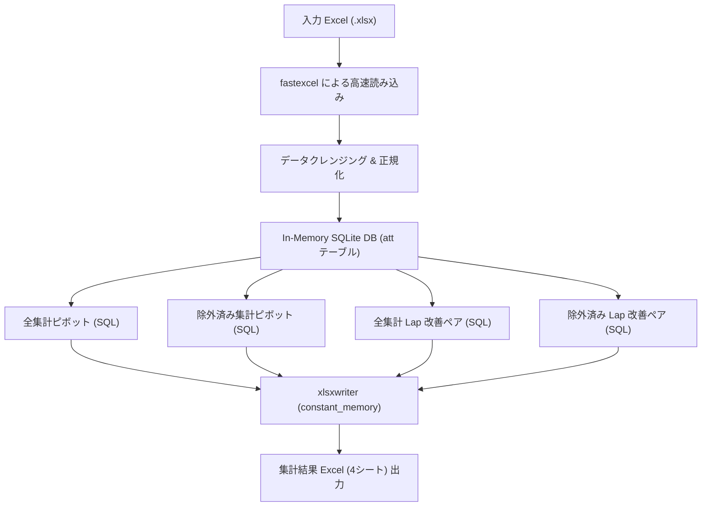

# MSL Checker - プロジェクトガイドライン & リファレンス

本ドキュメントは、**MSL Checker** リポジトリの構造、業務ロジック、技術スタック、開発・検証手順、およびコーディング規約をまとめたリファレンスです。
AIコーディングアシスタント（Antigravity / Gemini など）の参照コンテキストとして機能するとともに、開発者のオンボーディング資料を兼ねています。

---

## 1. プロジェクト概要

- **目的**: 学習塾・教育機関等の出席・授業実績 Excel データを読み込み、講師別・週別の授業実績、宿題提示状況、テスト実施率（ラップテスト・確認テスト）を高速集計し、Excel レポート（および Lap 改善ペアリスト）を自動生成する。
- **対象プラットフォーム**: Windows (Python 3.12, 仮想環境: `.venv`)
- **提供形態**:
  - Python スクリプト実行 (GUI: Tkinter)
  - スタンドアロン実行ファイル (`.exe`, Nuitka による C++ コンパイル & 単一バイナリ化)

---

## 2. ディレクトリ構成と役割

```text
MSL_Checker/
├── GEMINI.md                    # 本ドキュメント（リポジトリガイド・AIコンテキスト）
├── README.md                    # ユーザー向け概要・利用説明書
├── .venv/                       # Python 3.12 仮想環境
├── src/                         # アプリケーションソースコード
│   ├── MSLdata_check_v17.py     # 現行の最新バージョン本体スクリプト
│   ├── MSLdata_check_v1.py〜v16.py # 過去のバージョン履歴スクリプト
│   ├── requirements_v17.txt     # v17の依存ライブラリ一覧
│   └── requirements_*.txt       # 各バージョンごとの依存一覧
├── build/                       # EXE化（パッケージング）関連
│   ├── build2.py                # Nuitka ビルド自動化スクリプト
│   ├── logo.ico                 # アプリケーションアイコン
│   ├── splash.png               # 起動スプラッシュ画像
│   └── requirements-build.txt   # ビルド用依存関係 (nuitka, zstandard等)
├── test/                        # テスト & 検証スクリプト
│   ├── verify_output.py         # 最新バージョンの出力Excel整合性検証スクリプト
│   ├── test_lap_pairs.py        # Lapペア集計ロジックの単体・集計検証テスト
│   └── run_quick_test.py        # クイック動作確認スクリプト
├── bench/                       # ベンチマーク & サンプルデータ
│   ├── bench.py / bench2.py     # 処理速度・メモリ性能測定スクリプト
│   ├── sample.xlsx              # 動作検証用サンプルデータ
│   └── s*R_*D_*C_*T.xlsx        # 1万〜10万行規模の大規模パフォーマンステスト用データ
└── docs/                        # HTMLドキュメント、UIアセット、過去のVBAリファレンス
```

---

## 3. 技術スタック & アーキテクチャ

大規模データ（10万行規模）をデスクトップPCで高速かつ省メモリで処理するため、以下のライブラリ選定とパイプライン設計を採用しています。

| コンポーネント | 採用技術 | 選定理由・役割 |
| --- | --- | --- |
| **Excel 読み込み** | `fastexcel` + `pyarrow` | C/Rustベースの高速読み込み。必要に応じて `openpyxl` へのフォールバック機構を持つ。 |
| **データ加工・集計** | `sqlite3` (In-Memory `:memory:`) | インメモリ DB 上で SQL による高速なフィルタリング、グルーピング、ピボット集計を実施。 |
| **Excel 生成** | `xlsxwriter` | `{'constant_memory': True}` モードにより、数万行超のデータでもメモリ消費を一定に抑えて高速出力。 |
| **GUI** | `tkinter` | 標準ライブラリでファイル選択、進捗ダイアログ、エラーメッセージ表示を提供。 |
| **バイナリ化** | `Nuitka` | Python コードを C++ にトランスパイル・コンパイルし、高速かつ耐改ざん性の高い単一 EXE を生成。 |

### データ処理パイプライン



---

## 4. 主要業務ルール & 出力仕様

### 4.1 入力データの要件とクレンジング

- **必須列**:
  - `出欠`: `出席` のレコードのみを集計対象とする（欠席等は除外）。
  - `教室`: 教室名。`FS` や `ＦＳ` 等の文字列は正規表現 `r"(ＦＳ|FS|ｆｓ|fs)"` により自動除去・トリム。
  - `担当講師名`: 講師名。全角アルファベットやアンダースコア `r"[Ａ-Ｚ_]"` は正規表現で自動除去。全角文字は `unicodedata.normalize('NFKC', ...)` で半角化。
  - `担当講師N0`: 講師ID/社員番号。
- **集計対象の追加列**:
  - `生徒名`, `学年`, `科目`: ペア分析および除外判定に使用。
  - `日付` / `授業日`: 集計期間判定用（YYYY/MM/DD またはシリアル値に対応）。週の起算日（土曜起算 or 日曜起算）を設定可能。
  - `ラップテスト` 関連列: 列名に `ラップ` かつ `（分子）` を含む列で、値が存在（非空かつ `None` 以外）する場合に「Lapテスト実施」と判定。
  - `確認テスト` 関連列: 列名に `確認` を含み、点数・実施記録がある場合に「確認テスト実施」と判定。
  - `宿題名` / `宿題開始ページ` / `宿題終了ページ`: 宿題ページ数 = `(終了ページ - 開始ページ + 1)` で計算。

### 4.2 除外ルール (Exclusion Rules)

「除外済み集計」および「除外済みペアリスト」では、以下の条件に該当する授業データを除外（`excl_grade=0 AND excl_subj=0` のみ抽出）します：

- **学年除外 (`excl_grade`)**: 学年に `高3`, `高３`, `高卒` が含まれる場合
- **科目除外 (`excl_subj`)**: 科目に `国語`, `小論文` が含まれる場合
- **宿題除外キーワード**: 宿題名に単語帳・暗記系教材（`タンゴ`, `単語`, `シスタン`, `シス単`, `ターゲット`, `リープ`, `leap`, `ゲットスルー`, `パスタン`, `パス単`, `マドンナ`）が含まれる場合、ページ数集計から除外。

### 4.3 出力シート構成 (v17 仕様: 計4シート)

出力ファイル名形式: `集計結果_[YYYYMMDD-YYYYMMDD]_YYMMDD-HHMMSS.xlsx`

| シート名 | タブ色 | 基準・内容 |
| --- | --- | --- |
| **全集計** | 青系 (`#4F81BD`) | 全出席データの教室別・講師別・週別KPI（授業数、平均HW、Lap回数/％、テスト回数/％）および教室平均（AVG）行 |
| **除外済み集計** | 緑系 (`#4B6F44`) | 上記除外条件（高3・高卒・国語・小論文等）を除外したデータの週別KPIおよび教室平均（AVG）行 |
| **全集計ペアリスト** | オレンジ (`#E67E22`) | 全データ基準で、講師・生徒ペアごとの Lap 実施状況を集計。未実施が多いワースト順にソート |
| **除外済みペアリスト** | コーラルレッド (`#D9534F`) | 除外済みデータ基準で、講師・生徒ペアごとの Lap 実施状況を集計。未実施が多いワースト順にソート |

#### Lap 改善ペアリストの表示列 (12列)

1. `教室`
2. `講師No`
3. `担当講師名`
4. `生徒名`
5. `学年`
6. `科目`
7. `授業数`
8. `Lap回数`
9. `未実施数` (`授業数 - Lap回数`)
10. `ペアLap％`
11. `講師全体Lap％`
12. `生徒全体Lap％`

### 4.4 デザイン・スタイルの集中管理 (`AppConfig`)

フォント、用紙サイズ、マージン、アラート閾値、テーマカラーは、スクリプト先頭の `AppConfig` クラスで一元管理されています。

- **条件付き書式アラート閾値**:
  - `ALERT_HW_UNDER = 6.0`: 宿題平均が 6.0 ページ未満の場合にオレンジ背景
  - `ALERT_RATE_UNDER = 0.7`: ラップ率・テスト率が 70% 未満の場合に濃赤背景＋白文字
  - 未実施数セル: 未実施が 1 回以上ある場合に薄い黄色背景
- **印刷設定**: A4用紙 (`PAPER_SIZE = 9`), 縦向き (`IS_LANDSCAPE = False`), ページ幅に合わせて 1 ページ幅に自動収容 (`fit_to_pages(1, 0)`)
- **フォント**: `Noto Sans JP` を最優先とし、システム環境に応じてフォールバック

---

## 5. 開発 & 検証ワークフロー

### 5.1 仮想環境の準備とパッケージ

本プロジェクトはリポジトリ内の `.venv`（Python 3.12）を使用します。

```powershell
# 仮想環境のアクティベート（PowerShell）
.venv\Scripts\Activate.ps1

# 依存パッケージの確認・インストール（最新バージョン: v17）
.venv\Scripts\pip.exe install -r src/requirements_v17.txt
```

### 5.2 テスト・検証コマンド

変更を加えた際は、回帰検証テストを実行して出力結果の整合性を確認します。

```powershell
# 1. 出力Excelのシート構成・ヘッダー・データ整合性の自動検証
.venv\Scripts\python.exe test/verify_output.py

# 2. Lapペア集計ロジックの単体検証
.venv\Scripts\python.exe test/test_lap_pairs.py
```

### 5.3 アプリケーション実行

```powershell
# GUI モードで最新スクリプトを直接実行
.venv\Scripts\python.exe src/MSLdata_check_v17.py
```

### 5.4 Nuitka によるバイナリビルド (`build/build2.py`)

配布用 EXE は `build/build2.py` を使用してビルドします。

```powershell
# 開発用ビルド (コンソール画面あり、デバッグログ出力)
.venv\Scripts\python.exe build/build2.py -v 17 -m dev

# 本番リリース用ビルド (コンソール非表示、最適化、スプラッシュ画面・アイコン適用)
.venv\Scripts\python.exe build/build2.py -v 17 -m release

# コマンド内容の確認のみ（ドライラン）
.venv\Scripts\python.exe build/build2.py -v 17 -m release --dry-run
```

---

## 6. 開発規約 & ガイドライン（AI・開発者共通）

### 6.1 バージョン連番ファイル方式の運用ルール

- **新バージョンの作成**: 仕様変更や大幅な機能追加を行う際は、既存ファイルを直接壊さず、`src/MSLdata_check_v17.py` を複製して `src/MSLdata_check_v18.py` を作成します。
- **依存ファイルの追従更新**:
  1. `src/requirements_v<N>.txt` を作成または確認
  2. `test/verify_output.py` 内の読み込み対象モジュール（`msl_v<N>`）と期待値アサーションを更新
  3. `build/build2.py` の `MAX_VERSION` を新しいバージョン番号に更新
  4. 検証テストを実行し、全テストの通過を確認

### 6.2 パフォーマンス原則（10万行スケール）

- **メモリ制約**: `openpyxl` で大規模データを全展開して書き込むとメモリ不足（OOM）になるため、出力には必ず `xlsxwriter` の `constant_memory=True` を使用してください。
- **データ加工**: 複雑なループによる Python 側での集計を避け、SQLite の SQL インデックスと集約関数（`SUM`, `AVG`, `GROUP BY`）を活用してください。
- **ガベージコレクション**: 大規模な中間データ（タプルや辞書）を DB に投入した後は、明示的に参照を破棄し `gc.collect()` を呼ぶ設計を維持してください。

### 6.3 Windows 環境・文字コードの留意点

- 日本語フォント、Shift-JIS / CP932 / UTF-8 の混在に注意してください。
- ファイルパスの結合には必ず `os.path` または `pathlib.Path` を使用してください。
- スプラッシュ画面を閉じるための Win32 API 呼び出し（`dismiss_splash`）など、プラットフォーム固有の処理は `try-except` で保護してください。
